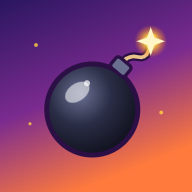

<p align="center">
  
</p>

<h1 align="center">Boom Buds</h1>

<p align="center">
  <b>The 1997 bomb-dropping party classic, rebuilt for the browser.</b><br>
  Up to ten bombers on one screen, across the room or across the internet.<br>
  Nothing to install, no server to run.
</p>

<p align="center">
  <a href="https://mayerwin.github.io/Boom-Buds/"><b>▶&nbsp;Play now</b></a>
  &nbsp;·&nbsp;
  <a href="#ways-to-play">Ways to play</a>
  &nbsp;·&nbsp;
  <a href="#play-on-a-tv">Play on a TV</a>
  &nbsp;·&nbsp;
  <a href="#how-to-play">How to play</a>
  &nbsp;·&nbsp;
  <a href="docs/ROADMAP.md">Roadmap</a>
</p>

<p align="center">
  <a href="https://github.com/mayerwin/Boom-Buds/actions/workflows/pages.yml"></a>
</p>

---

Boom Buds is a remake of **Atomic Bomberman** (Interplay / Hudson Soft, 1997) that runs in any modern browser, on
a computer, a phone or a tablet, and on Android TV. The rounds look, sound and play like the original: same pictures, sprites,
music, arenas and rules, re-implemented from a reverse-engineered specification of the game and compared with
it screenshot by screenshot. Around them, Boom Buds adds what a party game needs today: friendly menus,
gamepads and touch controls, online play without a server, and computer players worth beating.

## Features

- **Up to 10 players** in a match, any mix of people and computer players.
- **Up to 4 people on one device.** Keyboard (two layouts ready to use, or record your own), mouse, any USB or
  Bluetooth gamepad, or on-screen touch controls. Two players can share a phone or tablet.
- **Network play with zero setup.** Games on your network show up by themselves; friends elsewhere join with a
  6-character room code or a link. Browsers connect directly to each other, and rollback netcode keeps a LAN
  game at about one frame of input delay, and internet games at full speed and in sync (tested with up to
  100 ms each way). The lobby has a chat; the host decides the rules, and the others' wishes show up there as
  requests the host grants with a click.
- **The original 1997 computer player**, reverse engineered from the game (the default), and Boom Buds' own
  computer players with **five skill levels**, from *Rookie* to *Master*. The best ones dodge chain reactions,
  kick and punch bombs at you, and set traps.
- **Every rule of the original:** 11 arenas with conveyors, arrows, warps and trampolines; kicking, punching
  and grabbing bombs, trigger and jelly bombs, diseases, the walls closing in at the end of a round, schemes,
  teams and the Gold Bud roulette. The hidden campaign and level editor are there too.
- **1997 mode** brings back the original menus pixel for pixel, its hidden mouse and its waits between
  rounds (fast-forward stays), for one visit: the *1997 mode* link on the main screen, or [`?1997`](https://mayerwin.github.io/Boom-Buds/?1997)
  in the address (handy to share). Options can keep any of those habits for good.
- **Fast:** a WebGL2 8-bit renderer and a fixed 60 Hz simulation. Ten top-level computer players run at the
  display's full refresh rate on a tenth of one CPU core.

## Ways to play

| | Where | How to start | Controls |
|---|---|---|---|
| 💻 | **Computer**<br>Windows, macOS, Linux, ChromeOS | Open **[mayerwin.github.io/Boom-Buds](https://mayerwin.github.io/Boom-Buds/)** in Chrome, Edge, Firefox or Safari | Keyboard (two players), mouse, USB or Bluetooth gamepads |
| 📱 | **Phone or tablet**<br>Android, iPhone, iPad | Open the same address and hold the device sideways. *Add to Home screen* gives it an icon and the full screen | Touch (two players per device), Bluetooth gamepads or keyboard |
| 📺 | **TV**<br>Android TV, Google TV | The Boom Buds app, in a free beta on Google Play: [three steps](#play-on-a-tv) | TV remote, Bluetooth gamepads, keyboard, mouse |
| 🏠 | **Your own computer, offline**<br>LAN parties | [`Launch.bat` or `npm start`](#run-it-on-your-computer): the phones, tablets and computers of your network play from it, even without internet | All of the above |

All of them play together: a network game can bring a TV, two laptops and a phone into the same match. The
website updates itself: a game left open offers the new version in its main menu.

## Play on a TV

Boom Buds for **Android TV and Google TV** (Google TV Streamer, Chromecast with Google TV, TVs with Google TV
built in) is in a free beta on Google Play: the same game, sharp at 4K, with the TV remote or Bluetooth gamepads,
and sound effects in time with the picture. A Bluetooth or USB keyboard and a mouse work as on a computer.

1. **Join the tester group.** On a phone or a computer, signed in with the Google account of your TV, open
   the [tester group](https://groups.google.com/g/erwin-mayer-labs-beta/about) and choose **Join group**.
2. **Become a tester.** With the same account, open
   [play.google.com/apps/testing/com.github.boombuds](https://play.google.com/apps/testing/com.github.boombuds)
   and choose **Become a tester**.
3. **Install it.** Find Boom Buds in Google Play on your TV, or follow the download link of the testing
   page and pick your TV as the device.

No developer options, no sideloading. Google can take a few hours to let a new tester in, and the beta opens
once Google has approved its first release (submitted in October 2026). Google Play only accepts testers it knows,
which is why there are two steps; to invite someone, send the group's page: it links every app of the beta.
[Report a problem](https://github.com/mayerwin/Boom-Buds/issues).

| On the TV | Move | Bomb | Special | Pause |
|---|---|---|---|---|
| Gamepad | stick or d-pad | A | B | Start |
| TV remote | arrows | OK | hold OK (when it has a use) | Back |
| Keyboard | arrows, or E S D F | <kbd>.</kbd> or <kbd>A</kbd> | <kbd>,</kbd> or <kbd>Q</kbd> | Esc |

Up to four people play on one TV; Back on the main screen leaves the app. Developers can build and install it
themselves: [android/README.md](android/README.md).

## Run it on your computer

### Windows

1. Install [Node.js](https://nodejs.org) 22.18 or newer (the LTS version is fine).
2. Get this repository: [download the ZIP](https://github.com/mayerwin/Boom-Buds/archive/refs/heads/main.zip)
   and unzip it, or `git clone https://github.com/mayerwin/Boom-Buds.git`.
3. Double-click **`Launch.bat`**.

The first launch installs what the game needs and builds it, which takes a minute or two. Later launches start in
seconds. Your browser opens on `http://localhost:8080`; keep the window open while you play and close it to stop.

### macOS, Linux, or any terminal

```sh
npm install
npm start
```

### Play with other devices on your network

The launcher also prints your computer's address on the network, for example `http://192.168.1.20:8080`.
Phones, tablets and other computers can open it to play, and their network games meet through your computer, so
a LAN party works even without internet.

| Command | What it does |
|---|---|
| `Launch.bat` or `npm start` | Builds when something changed, serves the game on port 8080, opens the browser |
| `Launch.bat dev` or `npm start -- --dev` | Development server with live reload, on port 5173 |
| `npm start -- --port 9000` | Uses another port |
| `npm start -- --no-open` | Does not open a browser |
| `npm start -- --rebuild` | Builds again even if nothing changed |

## How to play

Blow up the bricks, grab power-ups, and be the last bud standing. Each round you win scores a point; the first
player to reach the number of wins set for the match takes it.

| Controls | Move | Bomb | Special |
|---|---|---|---|
| Keyboard, left side | <kbd>E</kbd> <kbd>S</kbd> <kbd>D</kbd> <kbd>F</kbd> | <kbd>A</kbd> | <kbd>Q</kbd> |
| Keyboard, right side | arrow keys | <kbd>.</kbd> | <kbd>,</kbd> |
| Gamepad | stick or d-pad | A | B (Start pauses) |
| Mouse | point where to walk | left button | right button |
| Touch screen | on-screen stick | A | B |

**Special** stops a bomb you kicked, punches the bomb in front of you (with the boxing glove) and sets off
trigger bombs. **Esc** pauses a round, in a network game for everybody: anyone can resume, and a 3, 2, 1
countdown starts everybody at once.

- To join a local game, press your bomb key or a gamepad button on the setup screen.
- Click your bomber to pick its colour. In team games the cards are white or red; ⇄ on a card moves that player
  to the other team, and the list shows how many play for each side.
- Above the arena, each player's name shows with a trophy (rounds won) and a skull (kills); team games show
  the team scores first. Playing alone on your device, your bomber glows under a "YOU" arrow at the start of
  each round.
- The arena can be one arena, a random one, a random *special* one (ice, arrows, warp holes, conveyor belts,
  trampolines, bricks that grow back), or a random one of your own pick: tick the arenas, and give the list a
  name to keep it.
- Once every person is out, the round fast-forwards while the computer players finish it: ← → set the speed
  (1× to 8×), ↑ or ↓ pauses (in network games the host decides). The end always plays at normal speed.
- Keyboard controls are physical key positions, so they work on AZERTY, QWERTZ and other layouts. Change them or
  record new ones in **Controls**; Keyboard right and left are also KEY 0 and KEY 1 in 1997 mode.
- Make your own arenas with the **Scheme editor** (Options → Extras); **My schemes** plays, exports and imports
  them.
- **How to Play** in the game lists every power-up.

### Network games

- **On the same network:** one player picks *Network Game → Create a game*. The game appears under *Games on
  your network* on the other devices; they click *Join*.
- **Anywhere else:** share the room code, or the link from *Copy link*. Friends enter the code under *Join with
  a code*.

Every device brings its own players (keyboards, gamepads, touch). The host adds computer players, picks the
arena and the rules, and starts the match.

<details>
<summary><b>How does it connect without a server?</b></summary>
<br>

Devices meet through free public MQTT brokers, several at once so that one being down does not matter. The
handshake is encrypted with a key derived from the room code. After that the browsers talk directly over WebRTC
data channels: inputs travel unordered and unacknowledged, with redundancy, and every device runs the same
deterministic simulation with rollback. Nobody runs a server or opens a port. Games on your network are found
through the public address your router shares, which each browser learns from a public STUN server.

A few networks, such as some mobile carriers and strict company firewalls, block direct connections between
browsers. A TURN relay gets around that. The build can be given one through `VITE_TURN_URLS`,
`VITE_TURN_USERNAME` and `VITE_TURN_CREDENTIAL` (or the repository variables `TURN_URLS`, `TURN_USERNAME` and
the secret `TURN_CREDENTIAL` in the deployment workflow), for example from a free Metered or Cloudflare account.

</details>

## Development

You need Node.js 22.18 or newer; the tools run TypeScript directly.

```sh
npm install
npm run dev         # http://localhost:5173 with live reload
npm run typecheck
npm test            # unit tests: simulation, level features, rollback netcode, rooms, computer players
npm run e2e         # browser tests (Playwright with Chrome): menus, local and network matches, original menus
npm run build       # production build in dist/
```

<details>
<summary><b>More tools and URL parameters</b></summary>
<br>

| Command | What it does |
|---|---|
| `node tools/dev/perf.ts "<url>?bench=10&level=10&ai=5" 20` | Frame rate and CPU use with ten computer players |
| `node tools/dev/net2.ts <url> [out] [seconds] [--code]` | Two browsers play a network game; their simulations are compared |
| `node tools/dev/netlag.ts <url> 20 0,0,0 50,10,1 100,20,2` | Two browsers play over simulated slow networks (delay and jitter in ms, loss in %): game speed, rollbacks, corrections |
| `node tools/dev/mobile.ts <url> [out] [device] [--two]` | The game on an emulated phone |
| `node tools/ai-arena.ts --quick` | Tournaments between computer players |
| `node tools/ai-bench.ts --level 5 --repeat 3` | CPU cost of the computer players per simulation tick |
| `E2E_URL=http://localhost:8080/ npm run e2e` | The browser tests against a production build (`npm start`) |

URL parameters: `?fps` shows the frame rate; `?bench=N&level=L&ai=S` runs endless demo rounds with N computer
players; `?join=CODE` joins a network game; `?relay=local` or `?relay=public` chooses where network games meet;
`?netsim=50,10,1` delays this browser's network messages (50 ms, plus up to 10 ms at random) and loses 1 % of its
input packets; `?1997` starts in 1997 mode.

</details>

### Game data

The pictures, sprites, sounds, music and level files in `public/data` are converted from an installed copy of the
original game. To convert them again (the audio needs `ffmpeg`):

```sh
npm run assets -- --src "C:/Games/BOMBERMAN"
```

### Releases

Every push to `main` runs the type check and the unit tests, builds the game and publishes it on GitHub Pages
([workflow](.github/workflows/pages.yml)). Every file the game loads has a content hash in its name or URL, and a
running game compares its build with the `version.json` of the site. Players get a new release the next time
they open the game, or from the main menu if it is already open.

### Project layout

| Path | Contents |
|---|---|
| [`src/engine`](src/engine) | WebGL2 8-bit renderer, asset loading, input, audio, touch controls |
| [`src/game/sim`](src/game/sim) | Deterministic simulation of a round: players, bombs, flames, power-ups, level features |
| [`src/game/ai`](src/game/ai) | Computer players (five skill levels) |
| [`src/menu`](src/menu) | The modern menus (Preact): local and network setup, lobby, controls, options, pause menu |
| [`src/net`](src/net) | Relays, rooms, network discovery, WebRTC mesh, rollback netcode |
| [`src/screens`](src/screens), [`src/ui`](src/ui) | The original screens, menus and dialogs |
| [`src/app`](src/app) | Program flow, settings, control sets, updates |
| [`server`](server) | Local server for `npm start` and LAN parties, with its relay |
| [`tools`](tools) | Launcher, build plugins, asset conversion, artwork sources, test and benchmark tools |
| [`android`](android) | The Android TV app: WebView host, TV controllers, native sound effects, build and Play publishing scripts |
| [`docs`](docs) | Differences from the original, verification, roadmap, specification of the original game |

## Documentation

- [Differences from the original](docs/DIFFERENCES.md): every deliberate change, and the original bugs that
  were fixed
- [Verification](docs/VERIFICATION.md): how Boom Buds was checked against the original (pixels, timing, network
  play, computer players, performance)
- [Roadmap](docs/ROADMAP.md): ideas for what comes next
- [Specification of the original game](docs/re): the reverse-engineered rules, screens and file formats

## Credits

**Producer / Director:** Erwin Mayer · **Lead Programmer:** Claude Opus (Anthropic)

Boom Buds is a fan project. It is not affiliated with or endorsed by Hudson Soft, Konami or Interplay. Atomic
Bomberman and its pictures, sounds and music belong to their owners.

The menu font is [Lilita One](https://fonts.google.com/specimen/Lilita+One) by Juan Montoreano, under the
[SIL Open Font License](src/menu/fonts/LICENSE.txt).
